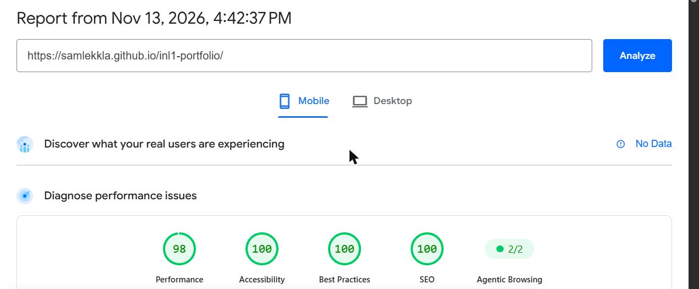
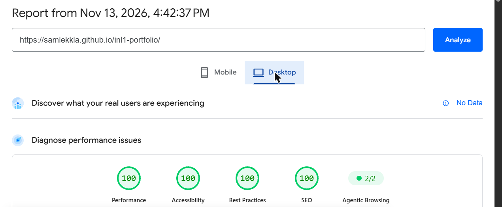
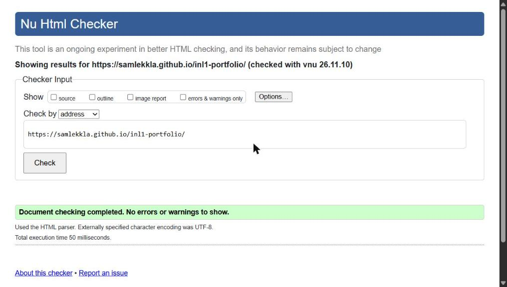
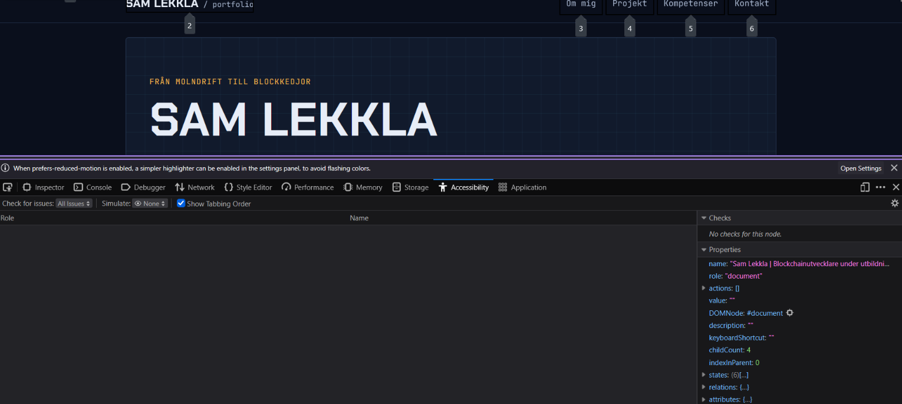

# Sam Lekkla – Portfolio

En personlig portfolio-webbplats byggd i HTML och CSS som inlämningsuppgift 1 i kursen HTML & CSS. Sidan presenterar mig som blockchainutvecklare under utbildning med bakgrund som junior molnadministratör. Den innehåller tre projekt, mina kompetenser och ett kontaktformulär.

- **Live-sida:** https://samlekkla.github.io/inl1-portfolio/
- **Repo:** https://github.com/samlekkla/inl1-portfolio

## Tekniker

- **HTML5** med semantiska element (`header`, `nav`, `main`, `section`, `article`, `aside`, `address`, `footer`)
- **CSS3** med CSS-variabler, Grid, Flexbox, `clamp()` och media queries
- **Google Fonts:** Chakra Petch (rubriker), IBM Plex Sans (brödtext) och JetBrains Mono (detaljer)
- **GitHub Actions** för automatisk publicering till GitHub Pages
- Ingen JavaScript och inga ramverk

## Filstruktur

```
inl1-portfolio/
├── index.html
├── css/
│   └── style.css
├── images/
│   ├── profil.jpg
│   └── screenshots/
├── .github/
│   └── workflows/
│       └── deploy.yml
├── .gitignore
└── README.md
```

## Responsiv design

Sidan är byggd **mobile first**. Grundstilarna gäller mobil, och två media queries med `min-width` bygger vidare för större skärmar:

| Skärm | Brytpunkt | Vad som ändras |
| --- | --- | --- |
| Mobil | under 48em | En kolumn, menyn radbryts, formulärfälten ligger under varandra |
| Tablet | från 48em (ca 768 px) | Sticky header, bild och text bredvid varandra, text och tekniker bredvid varandra i projektkorten, formuläret i två kolumner |
| Desktop | från 64em (ca 1024 px) | Grid med två kolumner: huvudinnehåll och ett sticky sidofält med kompetenser |

Brytpunkterna är satta i `em` så att layouten byts i rätt läge även när besökaren har förstorat texten. Rubrikerna skalar flytande med `clamp()`, och avstånd och storlekar anges i `rem` och `%`.

## Viktiga designval

- **Grid för sidlayouten.** Layouten är tvådimensionell. Introt spänner över båda kolumnerna och sidofältet spänner över flera rader, vilket Grid hanterar bättre än Flexbox.
- **Flexbox för meny och projektkort.** Båda flödar i en riktning. Menyn kan radbrytas, och i projektkorten hamnar text och tekniker bredvid varandra på större skärmar.
- **CSS-variabler i `:root`.** Färger, typsnitt, typskala och avstånd finns på ett ställe. Ljust läge byter bara variablernas värden.
- **Mörkt läge som standard, ljust läge via `prefers-color-scheme`.** Den mörka stilen passar tekniktemat, och den som har ljust läge i sitt system får en ljus version med samma kontrast.
- **Tillgänglighet.** Skip-länk, synliga `:focus-visible`-ramar, kontrast enligt WCAG AA, `label for` på alla fält, `fieldset` och `legend`, `autocomplete` och stöd för `prefers-reduced-motion`.
- **Formuläret skickas via Formspree.** GitHub Pages kan bara visa statiska filer, så formuläret postas till Formspree som mejlar meddelandet vidare. Det fungerar utan JavaScript.

## Tillgänglighetsgranskning

### Lighthouse

Testat med Lighthouse via PageSpeed Insights på live-sidan.

| | Performance | Accessibility | Best Practices | SEO |
| --- | --- | --- | --- | --- |
| Mobil | 98 | 100 | 100 | 100 |
| Desktop | 100 | 100 | 100 | 100 |





### W3C Validator

HTML:en ger 0 fel och 0 varningar i Nu Html Checker. CSS:en ger 0 fel i W3C CSS Validation Service. De varningar som finns kvar gäller CSS-variabler, som validatorn inte kan kontrollera statiskt.



### Firefox Accessibility Inspector

Med "Check for issues: All Issues" hittades inga problem, och listan är tom. "Show Tabbing Order" visar att tabbordningen följer sidans visuella ordning: skip-länk, logotyp och sedan menyn.



## Kör lokalt

Klona repot och öppna `index.html` i webbläsaren. Inget byggsteg behövs.

```bash
git clone https://github.com/samlekkla/inl1-portfolio.git
```
